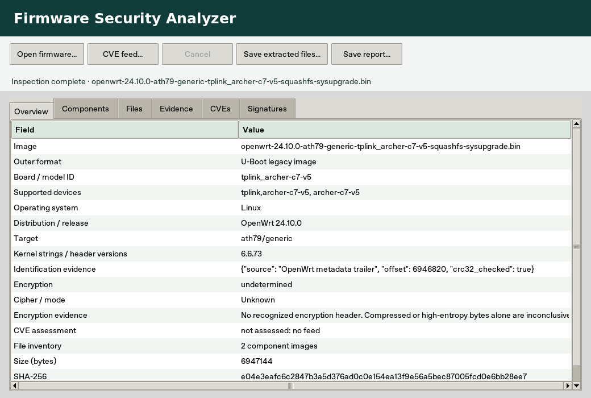

<p align="center"></p>

# Firmware Security Analyzer

Inspect a firmware image on your own machine. Open a component marker at its byte offset, review the evidence behind a security indicator, and save a report you can share.

[](https://github.com/Mustafaiq1998x/Firmware-Security-Analyzer/actions/workflows/tests.yml?query=branch%3Amain)
[](pyproject.toml)
[](LICENSE)

**[Walk through a sample report](docs/SAMPLE_REPORT.md)** · [Firmware test results](docs/FIRMWARE_VALIDATION.md) · [دليل البدء بالعربية](docs/START_AR.md) · [Release downloads](https://github.com/Mustafaiq1998x/Firmware-Security-Analyzer/releases)



## Portable Windows build

Open a successful [Windows desktop build](https://github.com/Mustafaiq1998x/Firmware-Security-Analyzer/actions/workflows/windows-desktop.yml), download **FSA-Windows-x64** under Artifacts, extract the ZIP, and launch **FSA.exe**. GitHub requires sign-in for workflow artifact downloads. The executable bundles Python and Tk. Each archive includes its SHA-256 checksum and license. These are unsigned test builds. Published release packages and their VirusTotal reports are listed separately under Releases.

## Run your first inspection

Clone the project and enter its directory.

```sh
git clone https://github.com/Mustafaiq1998x/Firmware-Security-Analyzer.git
cd Firmware-Security-Analyzer
```

| Linux or Kali | Windows PowerShell |
|---|---|
| `python3 -m venv .venv` | `py -3 -m venv .venv` |
| `.venv/bin/python -m pip install .` | `.\.venv\Scripts\python.exe -m pip install .` |
| `.venv/bin/fsa-gui` | `.\.venv\Scripts\fsa-gui.exe` |

Use **Open firmware…** in the native window. On Kali, install `python3-tk` if needed. Inspect the board, OS, compression, encryption evidence and file inventory, then save reports or extracted files. [Desktop guide](docs/DESKTOP.md) · [Optional bilingual web dashboard](docs/GUI.md)

## What the report tells you

| Question | Evidence |
|---|---|
| Which file did I inspect? | Filename, byte count and SHA-256. |
| Where are the component markers? | Searchable signatures with offsets and magic bytes. A marker is a lead for a format-specific parser. |
| What triggered a finding? | A rule, confidence and sampled evidence from printable strings. |
| What is inside this ZIP or TAR? | Optional bounded extraction returns paths, byte counts and per-file hashes. [Extraction limits](docs/EXTRACTION.md) |
| What can I share? | Full JSON, a printable dashboard and a standalone HTML report from the CLI. Review firmware-derived text for sensitive data before sharing. |

## Command line

With the virtual environment active:

```sh
fsa scan samples/demo_firmware.bin --out report.json --html report.html
fsa extract firmware.tar --outdir extracted --report manifest.json
fsa info samples/demo_firmware.bin
```

Core CLI installation uses `python -m pip install .`. The CLI scan defaults to 512 MiB. The extraction command supports ZIP and TAR. SquashFS and UBIFS appear as preliminary markers. Optional kernel advisory matching uses a local feed and requires vendor-specific review. [CLI and offline feed reference](docs/CLI.md)

## Verify a download

Look for the exact asset name and SHA-256 in its [GitHub release notes](https://github.com/Mustafaiq1998x/Firmware-Security-Analyzer/releases). When the VirusTotal workflow has completed, that row links to the dated multi-engine report. An absent row means verification has not been published for that file. Firmware submitted through the dashboard stays local.

## Project guide

[Methodology](docs/METHODOLOGY.md) · [Testing](docs/TESTING.md) · [Roadmap](docs/ROADMAP.md) · [Changelog](CHANGELOG.md) · [Reference tools](docs/REFERENCE_TOOLS.md)

Browse related GitHub topics: [firmware-analysis](https://github.com/topics/firmware-analysis) · [embedded-linux](https://github.com/topics/embedded-linux) · [static-analysis](https://github.com/topics/static-analysis) · [iot-security](https://github.com/topics/iot-security)

### Tested TP-Link router images

Recognition uses firmware bytes and partition bounds, so renaming a file does not change its identity.

| Image tested | Container | Identification verified |
| --- | --- | --- |
| Archer AX10 1.3.11 build 20250325 | Cloud SafeLoader | Device support list, board, ARMv7, Linux 4.1.52 |
| Archer C7 v5 OpenWrt 24.10.0 factory | Factory SafeLoader | C7 v5 support list, MIPS, OpenWrt Linux 6.6.73 |
| TL-WR841N(UN) v8 170210 | Legacy TP-Link v1 with bootloader and nested header | Hardware ID 0x08410008, firmware 3.16.9, MIPS32 Release 2, Linux 2.6.31 |

Other models using a recognized layout can expose their own header fields. Legacy hardware IDs without a verified mapping remain numeric. Coverage depends on hardware revision, image type and header variant. These tests do not establish coverage of the complete TP-Link catalog.

[Full router compatibility results by image and SHA-256](docs/ROUTER_COMPATIBILITY.md)

[Multi-vendor router coverage and stock firmware test results](docs/MULTIVENDOR.md)

[Camera, recorder, satellite, system, Android, audio, lighting and printer firmware coverage](docs/DEVICE_FIRMWARE.md)
